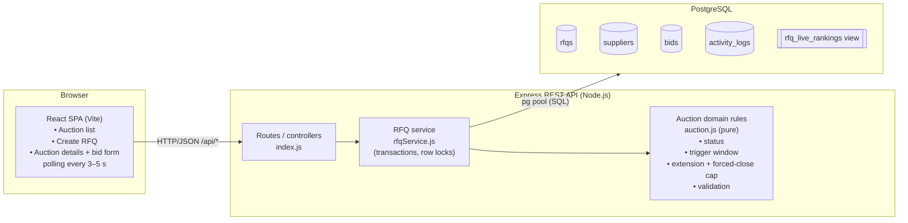

# High-Level Design: British Auction RFQ System

## 1. Overview
A simplified RFQ (Request for Quotation) platform where buyers create RFQs with **British Auction** bidding.
Suppliers submit quotes openly and keep lowering their price. A bid near the end can **extend** the auction,
but it can never go past the **forced close time**.

**Stack:** React (Vite) SPA → REST API (Node.js + Express) → PostgreSQL.

## 2. Architecture diagram



### Components
| Component | Responsibility |
|---|---|
| **React SPA** | Listing page (status filters, live countdowns), RFQ creation form with client-side validation, details page (rankings L1/L2/…, quote breakdown, X/Y config, activity log, quote submission). Polls the API and corrects the countdown with the server clock offset (`server_time`). |
| **Routes** (`index.js`) | HTTP routing, id parsing, JSON errors (`400` validation, `404`, `409` auction not open / duplicate ref). |
| **Service** (`rfqService.js`) | Use-case orchestration: create RFQ, list, details, submit bid. Owns DB transactions. |
| **Domain** (`auction.js`) | Pure functions with no I/O: `computeStatus`, `isInTriggerWindow`, `evaluateExtension`, input validation. Unit tested (`npm test`). |
| **PostgreSQL** | Source of truth. CHECK constraints enforce the validation rules again at the DB level. `rfq_live_rankings` view computes rankings. |

## 3. API (REST)

| Method | Path | Description |
|---|---|---|
| `GET`  | `/api/health` | Liveness + DB check |
| `GET`  | `/api/rfqs` | Listing: name/ref, current lowest bid, L1 supplier, current close, forced close, status, extension count |
| `POST` | `/api/rfqs` | Create RFQ with British Auction config (X, Y, trigger) |
| `GET`  | `/api/rfqs/:id` | Details: RFQ + config, `rankings` (latest bid per supplier, L1…Ln), `bids` (full history), `activity` log |
| `POST` | `/api/rfqs/:id/bids` | Submit / revise a quote. Returns the bid, its rank, the extension (if any) and the refreshed RFQ |

Validation errors return `400 { error, details: { field: message } }`.

## 4. Key flow: submit bid

```mermaid
sequenceDiagram
    participant S as Supplier (React)
    participant A as Express API
    participant P as PostgreSQL
    S->>A: POST /api/rfqs/:id/bids
    A->>A: validate payload
    A->>P: BEGIN; SELECT * FROM rfqs WHERE id=$1 FOR UPDATE
    A->>A: now := clock (after lock); status must be ACTIVE
    A->>P: upsert supplier; read rankings (before)
    A->>A: new total must be < supplier's own current bid
    A->>P: INSERT bid; read rankings (after); log BID_SUBMITTED
    A->>A: evaluateExtension(rfq, now, before, after)
    alt in last X min AND trigger condition met
        A->>P: UPDATE rfqs SET current_bid_close_at = min(close + Y, forced)
        A->>P: INSERT activity_logs TIME_EXTENDED (reason, old→new close, capped?)
    end
    A->>P: COMMIT
    A-->>S: 201 { bid, extension, rfq }
```

## 5. Auction rules (as implemented)

**Status** is computed from time on every read, so no background job is needed:
- `UPCOMING`: now < bid start
- `ACTIVE`: bid start ≤ now < current close
- `CLOSED`: now ≥ current close, and current close < forced close
- `FORCE_CLOSED`: now ≥ current close, and extensions pushed current close up to the forced close time

**Trigger window:** `[current_close − X, current_close)`. It moves with each extension.

**Extension triggers** (one per RFQ):
| Trigger | Extends when (inside the window) |
|---|---|
| `BID_RECEIVED` | any accepted bid |
| `ANY_RANK_CHANGE` | any supplier that already held a rank now holds a different rank (an underbid that reorders suppliers, or a new entrant who pushes others down). A new supplier entering in last place does not count. |
| `L1_RANK_CHANGE` | the supplier at L1 is different after the bid (including the very first bid) |

**Extension amount:** `new_close = min(current_close + Y, forced_close)`. The spec example extends 6:00 → 6:05, so Y is added to the current close time, not to the bid time. If the cap applies, the log marks the extension as *capped*. Once current close equals forced close, no further extension is possible.

**Bidding rules**
- A supplier's live bid is their **latest** bid. Every revision is kept in `bids` as history.
- A revision must be strictly lower than the supplier's current total (British auction).
- Rank = ascending total (freight + origin + destination). Ties go to the earlier bid.
- Bids are rejected (`409`) when the auction is not `ACTIVE`.

## 6. Design decisions & trade-offs
- **Concurrency:** `SELECT … FOR UPDATE` on the RFQ row serialises bids on the same auction. The before/after ranking comparison and the close-time update are therefore atomic, and two bids landing together cannot both read the old close time. Bids on different auctions don't block each other.
- **Clock:** the server clock is taken after the lock is acquired, which is the authoritative time. The UI uses `server_time` to correct for client clock drift.
- **Defence in depth:** forced close > close > start and `current_close ≤ forced_close` are validated in the API **and** enforced by DB CHECK constraints.
- **Realtime:** short polling (3 s on details, 5 s on list) keeps it simple. In production this would be WebSockets/SSE, fanned out via Redis pub/sub across API instances.
- **Status without cron:** status is derived from timestamps, which avoids scheduler drift. A worker could be added later to send "auction closed" notifications.
- **Out of scope (simplified):** authentication and roles (supplier types their company name), multi-currency, award workflow.
