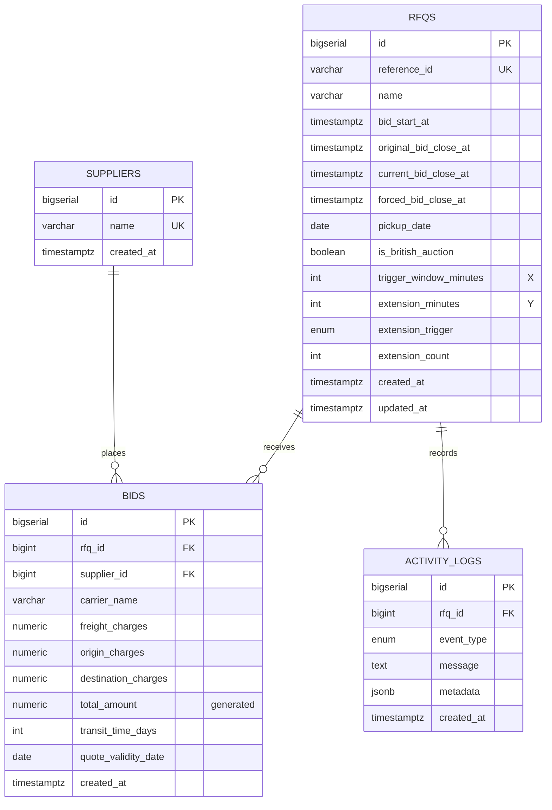

# Database Schema Design (PostgreSQL)

Source: [`db/schema.sql`](../db/schema.sql)

## Tables

### `rfqs`
One row per RFQ. The British Auction configuration is 1:1 with the RFQ, so it is stored inline.
| Column | Type | Notes |
|---|---|---|
| `id` | BIGSERIAL PK | |
| `reference_id` | VARCHAR(50) UNIQUE | RFQ reference, e.g. `RFQ-1001` |
| `name` | VARCHAR(200) | RFQ name |
| `bid_start_at` | TIMESTAMPTZ | |
| `original_bid_close_at` | TIMESTAMPTZ | Close time as configured (kept for audit) |
| `current_bid_close_at` | TIMESTAMPTZ | Live close time; moves forward on extensions |
| `forced_bid_close_at` | TIMESTAMPTZ | Hard stop |
| `pickup_date` | DATE | Pickup / service date |
| `is_british_auction` | BOOLEAN | Always true here; allows other auction types later |
| `trigger_window_minutes` | INT > 0 | **X** |
| `extension_minutes` | INT > 0 | **Y** |
| `extension_trigger` | ENUM | `BID_RECEIVED` / `ANY_RANK_CHANGE` / `L1_RANK_CHANGE` |
| `extension_count` | INT | Number of extensions applied |

Constraints:
- `chk_close_after_start`: `original_bid_close_at > bid_start_at`
- `chk_forced_after_close`: `forced_bid_close_at > original_bid_close_at` (*Forced close must be greater than bid close*)
- `chk_current_within_forced`: `original ≤ current_bid_close_at ≤ forced_bid_close_at` (*extensions never exceed forced close*)

### `suppliers`
| Column | Type | Notes |
|---|---|---|
| `id` | BIGSERIAL PK | |
| `name` | VARCHAR(200) UNIQUE | Upserted on bid submission (no auth in this demo) |

### `bids`
Append-only quote history. A supplier's **latest** row for an RFQ is their live bid.
| Column | Type | Notes |
|---|---|---|
| `rfq_id` | FK → rfqs | ON DELETE CASCADE |
| `supplier_id` | FK → suppliers | |
| `carrier_name` | VARCHAR | |
| `freight_charges`, `origin_charges`, `destination_charges` | NUMERIC(14,2) ≥ 0 | |
| `total_amount` | NUMERIC(14,2) **GENERATED** | Sum of the three charges; used for ranking |
| `transit_time_days` | INT > 0 | |
| `quote_validity_date` | DATE | |
| `created_at` | TIMESTAMPTZ | Bid time (tie-breaker for equal totals) |

Indexes: `(rfq_id, supplier_id, created_at DESC)` for latest-bid lookup; `(rfq_id, total_amount)`.

### `activity_logs`
Audit trail shown on the details page.
| Column | Type | Notes |
|---|---|---|
| `event_type` | ENUM | `RFQ_CREATED`, `BID_SUBMITTED`, `TIME_EXTENDED` |
| `message` | TEXT | Human-readable line |
| `metadata` | JSONB | For `TIME_EXTENDED`: `reason`, `trigger`, `previous_close_at`, `new_close_at`, `capped_at_forced_close` |

Index: `(rfq_id, created_at DESC)`.

### View `rfq_live_rankings`
Takes the latest bid per (rfq, supplier) with `DISTINCT ON`, then ranks it with
`ROW_NUMBER() OVER (PARTITION BY rfq_id ORDER BY total_amount, created_at)`. This gives rank 1 = **L1**, 2 = L2, and so on.
